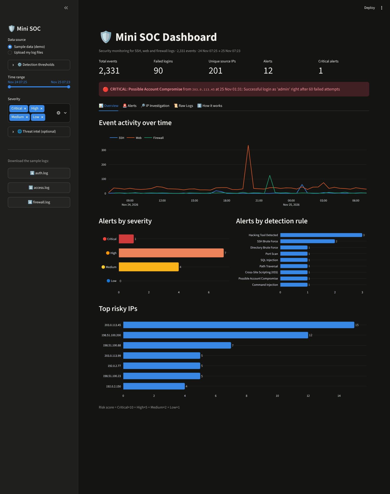
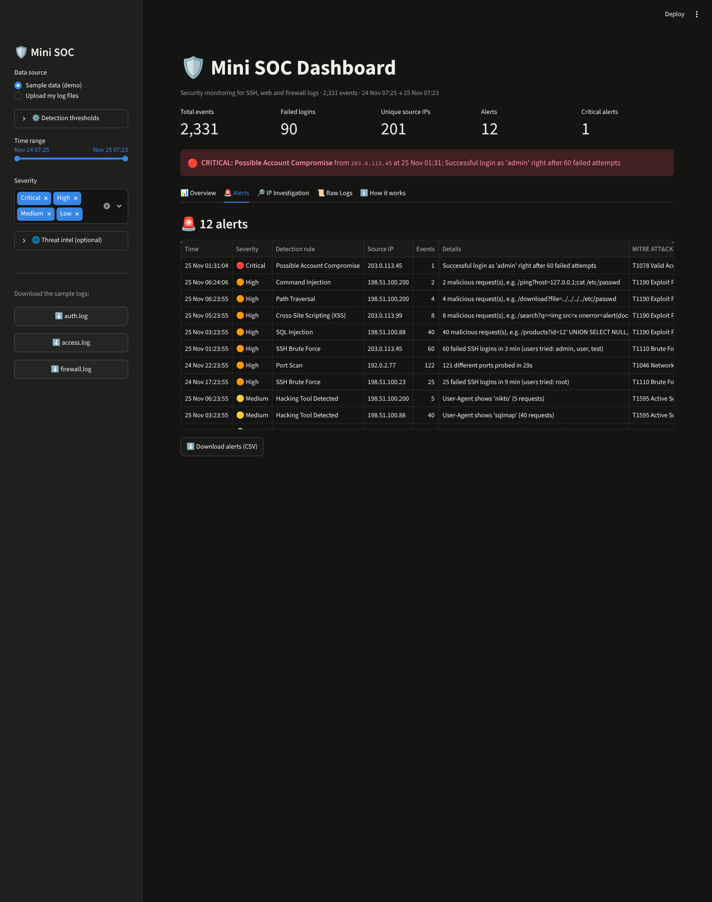

# 🛡️ Mini SOC Dashboard

A lightweight **Security Operations Center (SOC) dashboard** built with **Python + Streamlit**.
It parses SSH, web server and firewall logs, **detects attacks** such as brute force, port scans,
SQL injection and XSS, maps them to **MITRE ATT&CK**, and helps an analyst investigate suspicious IPs.


🔗 **Live demo:** _add your Streamlit link here after deploying_



---

## ✨ Features

- 📥 **Multi-source log parsing:** OpenSSH auth logs, Apache/Nginx access logs, Linux UFW firewall logs (auto-detected)
- 🚨 **9 detection rules** with severity levels (Critical / High / Medium)
- 🧭 **MITRE ATT&CK mapping** for every alert
- 📊 **Interactive dashboard:** KPIs, event timeline, alerts by severity and rule, top risky IPs
- 🔎 **IP investigation:** full activity history and alerts for one IP
- 🌐 **Threat intelligence:** optional AbuseIPDB reputation lookup
- ⚙️ **Tunable thresholds** from the sidebar
- 📤 **Upload your own logs** or use the built-in demo data
- ⬇️ **Export alerts to CSV**
- ✅ **Unit tests** for parsers and detection rules

## 🚨 Detection Rules

| Rule | Logic | Severity | MITRE ATT&CK |
|---|---|---|---|
| SSH Brute Force | ≥5 failed SSH logins from one IP within 5 min | High | T1110 Brute Force |
| Possible Account Compromise | Successful login from an IP that was brute forcing | **Critical** | T1078 Valid Accounts |
| Port Scan | ≥10 distinct ports hit within 60 s | Medium / High | T1046 Network Service Discovery |
| SQL Injection | `UNION SELECT`, `' OR '1'='1`, `SLEEP(`, `DROP TABLE` in URL | High | T1190 Exploit Public-Facing App |
| Cross-Site Scripting | `<script>`, `onerror=`, `javascript:` in URL | High | T1190 |
| Path Traversal | `../`, `/etc/passwd`, `win.ini` in URL | High | T1190 |
| Command Injection | `;cat`, `&& whoami`, `\| ls` in URL | High | T1190 |
| Hacking Tool Detected | User-Agent of sqlmap, nikto, gobuster, nmap, etc. | Medium | T1595 Active Scanning |
| Directory Brute Force | ≥20 HTTP 4xx errors within 60 s | Medium | T1595.003 Wordlist Scanning |

## 🧪 Demo Data

The built-in generator creates 24 hours of logs with normal traffic plus 7 attack scenarios:

| Scenario | Attacker IP |
|---|---|
| SSH brute force **followed by a successful login** | 203.0.113.45 |
| SSH brute force (failed) | 198.51.100.23 |
| Port scan (120+ ports in 30 s) | 192.0.2.77 |
| SQL injection with sqlmap | 198.51.100.88 |
| XSS attempts | 203.0.113.99 |
| Directory brute force with gobuster | 192.0.2.150 |
| Path traversal and command injection with Nikto | 198.51.100.200 |

> All attacker IPs come from the reserved **RFC 5737 documentation ranges**, so no real person's IP is labelled malicious.

## 🚀 Run Locally

```bash
git clone https://github.com/rizwankarimlam/mini-soc-dashboard.git
cd mini-soc-dashboard

python -m venv venv
# Windows
venv\Scripts\activate
# Mac/Linux
source venv/bin/activate

pip install -r requirements.txt
streamlit run app.py
```

The dashboard opens at **http://localhost:8501**.

### Run the tests

```bash
pip install pytest
python -m pytest
```

### (Optional) AbuseIPDB lookups

1. Create a free account at [abuseipdb.com](https://www.abuseipdb.com) and copy your API key.
2. Paste it in the sidebar under **Threat intel**, or create `.streamlit/secrets.toml`:
   ```toml
   ABUSEIPDB_API_KEY = "your-key-here"
   ```
   (`secrets.toml` is in `.gitignore`, so it is never pushed to GitHub.)

## ☁️ Deploy for Free (Streamlit Community Cloud)

1. Push this repo to GitHub.
2. Go to [share.streamlit.io](https://share.streamlit.io) and sign in with GitHub.
3. Click **Create app**, choose this repo, branch `main`, main file `app.py`.
4. Click **Deploy**. Your dashboard gets a public URL.
5. (Optional) Add `ABUSEIPDB_API_KEY` under **App settings → Secrets**.

## 📁 Project Structure

```
mini-soc-dashboard/
├── app.py                 # Streamlit dashboard (UI)
├── soc/
│   ├── parsers.py         # Log parsing (SSH, web, firewall)
│   ├── detectors.py       # Detection rules + MITRE mapping + risk score
│   ├── enrich.py          # AbuseIPDB threat-intel lookup
│   └── generator.py       # Synthetic log generator for the demo
├── sample_logs/           # Example log files you can upload
├── tests/test_soc.py      # Unit tests
├── generate_logs.py       # Re-create sample_logs/
├── screenshots/
├── .streamlit/config.toml # Dark theme
└── requirements.txt
```

## 📸 Screenshots

| Overview | Alerts |
|---|---|
|  |  |

## 🔮 Future Improvements

- [ ] GeoIP world map of attacker locations
- [ ] Windows Event Log support (failed logons, Event ID 4625)
- [ ] Email / Telegram alerts for Critical events
- [ ] Sigma rule import
- [ ] Real-time log tailing

## ⚖️ Disclaimer

For education and defensive security only. Analyse logs only from systems you own or are authorised to monitor.

## 📄 License

MIT
